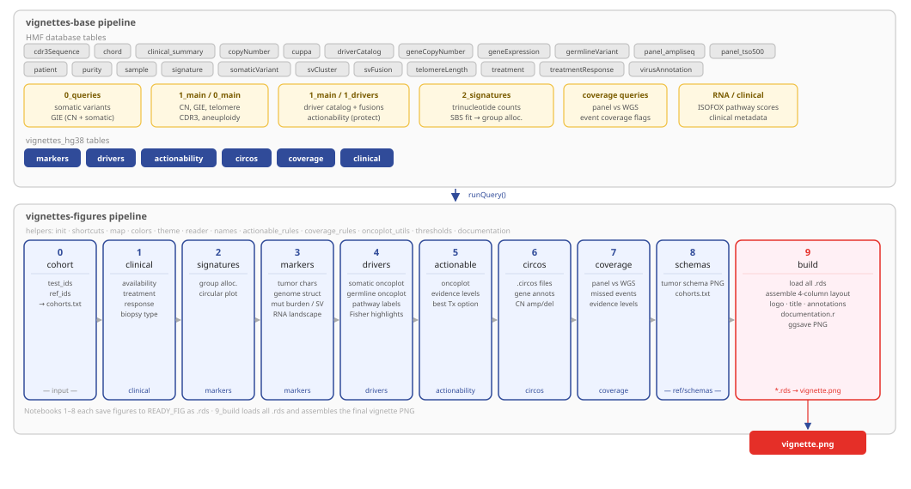
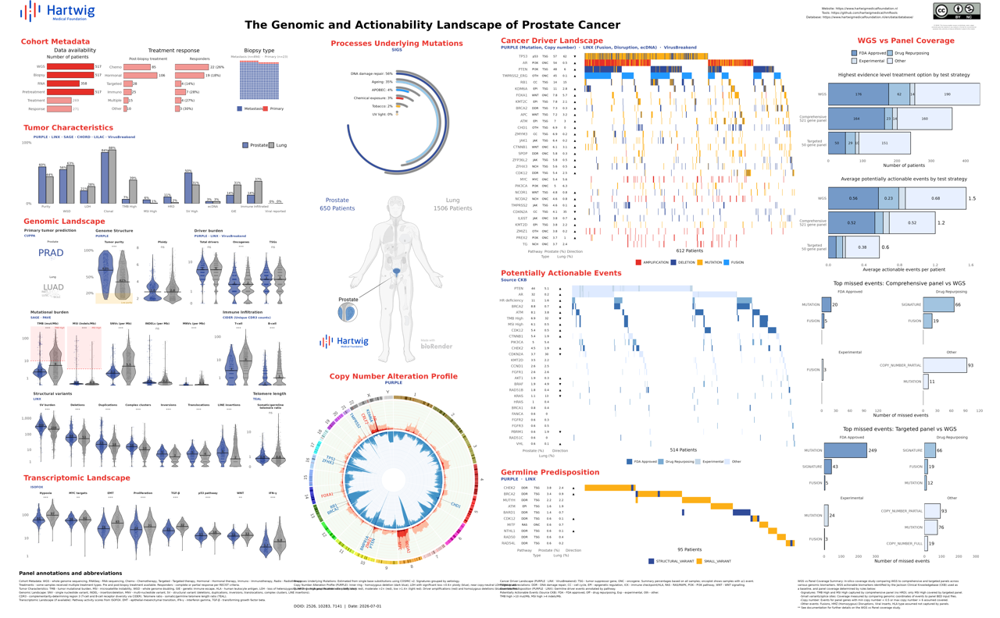

# vignettes-figures

A Jupyter-based R pipeline that compares a **test cohort** against a **reference cohort** across genomic, clinical, and actionability dimensions, producing a single publication-ready vignette PNG.



---

## Example output



---

## Overview

Each notebook queries the `vignettes_hg38` database schema (produced by the companion **[vignettes-base](https://github.com/hartwigmedical/vignettes-base)** pipeline), generates figures, and saves them as `.rds` files. The final notebook (`9_build.ipynb`) assembles all figures into a single vignette.

---

## Prerequisites

### R packages

```r
install.packages(c(
  "tidyverse", "data.table", "dtplyr",
  "ggplot2", "cowplot", "gridExtra", "ggpubr",
  "ggtext", "png", "grid", "scales"
))
```

### External tools

| Tool | Path (configured in `helpers/map.r`) |
|---|---|
| Circos | `/data/tools/circos/0.69.6/bin/circos` |
| Jupyter + IRkernel | Required to run notebooks and `run.sh` |

### nbstripout (required before first use)

`nbstripout` strips cell outputs from notebooks before they are committed to git, keeping the repository clean and diffs readable.

Install and activate it once per clone:

```bash
pip install nbstripout
nbstripout --install
```

Running `nbstripout --install` inside the repository directory registers a git filter that automatically strips outputs on every `git add`. Without this step, notebook outputs (figures, dataframes, error traces) will be committed to the repository.

---

## Configuration

Edit the top two lines of `helpers/map.r` to switch between dev and prod environments:

```r
REF_REPO <- "/data/repos/cancer-vignettes-dev/"
REF_DATA <- "/data/tmp/vignettes-dev/"
```

All other paths (`READY_DATA`, `READY_FIG`, `SHARE_FIG`, etc.) are derived from these two variables.

---

## Repository structure

```
vignettes-figures/
│
├── 0_cohort.ipynb         # Define test and reference cohorts → cohorts.txt
├── 1_clinical.ipynb       # Clinical metadata figures
├── 2_signatures.ipynb     # Mutational signature plot
├── 3_markers.ipynb        # Genomic landscape overview
├── 4_drivers.ipynb        # Cancer driver oncoplot
├── 5_actionable.ipynb     # Actionable event oncoplot
├── 6_circos.ipynb         # Copy-number circos plot
├── 7_coverage.ipynb       # WGS vs panel coverage comparison
├── 8_schemas.ipynb        # Tumor schema figure
├── 9_build.ipynb          # Assemble final vignette PNG
│
├── run.sh                 # Run all notebooks sequentially
│
├── helpers/
│   ├── init.r             # Sources all helpers in one call (used by each notebook)
│   ├── map.r              # File path variables (edit to switch dev/prod)
│   ├── shortcuts.r        # runQuery(), utility functions
│   ├── colors.r           # Color palettes and fill maps
│   ├── theme.r            # Shared ggplot2 theme
│   ├── reader.r           # ggit() image reader helper
│   ├── names.r            # Label maps: schema_map, cuppa_name_map, etc.
│   ├── actionable_rules.r # Evidence level maps and panel definitions
│   ├── coverage_rules.r   # Coverage rule functions and panel maps
│   ├── oncoplot_utils.r   # Shared oncoplot ordering and Fisher highlight utilities
│   ├── thresholds.r       # Clinical thresholds and vignette output constants
│   └── documentation.r    # Vignette bottom-panel annotation strings
│
├── circos_conf/           # Circos configuration files
│   ├── go.conf            # Main circos config (entry point)
│   ├── karyotype.human.hg38.txt
│   └── ...
│
└── ref/
    ├── schemas/           # Tumor location schema PNG files
    ├── logo/              # Hartwig logo files
    ├── pathways/          # Pathway definitions
    └── gene_locations.txt # Gene chromosome positions for circos annotation
```

---

## Cohort definition

`0_cohort.ipynb` defines which samples belong to the test and reference cohorts. It writes `cohorts.txt` to `READY_DATA`, which all downstream notebooks read.

The cohort can be defined by any filter on the clinical or markers data — primary tumor location, molecular markers, biopsy site, treatment, or a hand-curated list of sample IDs:

```r
test_name <- "Prostate"
test_ids  <- tmp %>% filter(primaryTumorLocation == "Prostate") %>% pull(sampleId)

ref_name  <- "Lung"
ref_ids   <- tmp %>% filter(primaryTumorLocation == "Lung") %>% pull(sampleId)

location  <- "Prostate"   # must be a valid primaryTumorLocation (validated against schema_map)
```

### cohorts.txt format

The output file has the following columns and can also be produced externally (e.g. from a MySQL Workbench export or a script) and supplied directly to `run.sh` as a CSV:

| Column | Description |
|---|---|
| `sampleId` | HMF sample identifier |
| `ref` | `TRUE` for reference cohort, `FALSE` for test cohort |
| `cohort` | Short cohort label used in plot axes (e.g. `"Prostate"`) |
| `primaryTumorLocation` | Primary tumor location (must match a key in `schema_map`) |
| `title` | Full cancer type label used in the vignette title (e.g. `"Prostate Cancer"`) |

`doids` (Disease Ontology IDs) are looked up automatically by `0_cohort.ipynb` and do not need to be supplied in an external CSV.

---

## Running the pipeline

### Run all notebooks (including cohort definition)

```bash
bash run.sh
```

Runs every notebook from `0_cohort.ipynb` to `9_build.ipynb`. Use this when defining cohorts interactively inside `0_cohort.ipynb`.

### Supply a cohorts CSV file (skip 0_cohort)

```bash
bash run.sh cohorts.csv
```

Copies the CSV to `READY_DATA/cohorts.txt` and starts the pipeline at `1_clinical.ipynb`, skipping `0_cohort.ipynb`. This is the recommended entry point when cohort membership is defined externally. The CSV must contain the columns described in the **cohorts.txt format** table above.

### Start from a specific notebook

```bash
bash run.sh 5_actionable.ipynb
```

Each notebook is executed in-place using `jupyter nbconvert --execute --inplace` with the IRkernel. The pipeline stops immediately if any notebook fails.

---

## Notebooks

| Notebook | Queries | Saves |
|---|---|---|
| `0_cohort.ipynb` | `clinical`, `markers` (base schema) | `cohorts.txt` |
| `1_clinical.ipynb` | `clinical`, `markers` | `clinical.rds` |
| `2_signatures.ipynb` | `markers` | `signatures.rds` |
| `3_markers.ipynb` | `markers` | `markers.rds` |
| `4_drivers.ipynb` | `drivers` | `drivers.rds` |
| `5_actionable.ipynb` | `actionability` | `actionable.rds` |
| `6_circos.ipynb` | `circos`, `drivers` | `circos_amps.circos`, `circos_dels.circos`, `circos_amp_del_genes.circos`, `circos.png` |
| `7_coverage.ipynb` | `coverage` | `coverage.rds` |
| `8_schemas.ipynb` | — (reads `cohorts.txt`) | `schemas.rds` |
| `9_build.ipynb` | — (reads all `.rds`) | `<cohort>_vignette.png` in `SHARE_FIG` |

---

## Database schema

All tables are in the `vignettes_hg38` schema, built by the **vignettes-base** pipeline:

| Table | Contents |
|---|---|
| `clinical` | Treatment, response, biopsy site, data availability flags |
| `markers` | Per-sample genomic landscape: TMB, MSI, SVs, CN, signatures, CUPPA, RNA |
| `drivers` | Somatic and germline driver events |
| `actionability` | Highest evidence-level actionable event per sample (CKB) |
| `circos` | Per-bin copy-number amplitude and deletion values |
| `coverage` | Per-sample WGS vs TSO500 vs amplicon panel coverage flags |

---

## Helpers

| File | Purpose |
|---|---|
| `init.r` | Sources all helpers in one call — each notebook runs `source("helpers/init.r")` |
| `map.r` | All file path variables — edit `REF_REPO` and `REF_DATA` to switch environments |
| `shortcuts.r` | `runQuery()` for database access, `clean_filename()`, shared library loading |
| `colors.r` | `hartwig_red`, `fills`, `sig_colors`, `driver_fill_map`, `actionable_fill_map` |
| `theme.r` | `base_theme`, `set_title()`, `no_y` and other ggplot2 helpers |
| `reader.r` | `ggit()` — reads a PNG file into a ggplot object |
| `names.r` | `schema_map` (location → schema PNG), `cuppa_name_map`, and other label maps |
| `actionable_rules.r` | Evidence level ordering, `level_map`, `panel_maps`, fill maps |
| `coverage_rules.r` | Coverage rule functions and panel definitions for `7_coverage.ipynb` |
| `oncoplot_utils.r` | `order_oncoplot()`, `get_entity_order()`, `get_fisher_highlights()` — shared by `4_drivers` and `5_actionable` |
| `thresholds.r` | Clinical constants: `TMB_HIGH_THRESHOLD`, `MSI_HIGH_THRESHOLD`, `PURITY_LOW_THRESHOLD`; output constants: `VIGNETTE_WIDTH`, `VIGNETTE_HEIGHT`, `VIGNETTE_DPI` |
| `documentation.r` | Vignette bottom-panel annotation strings: `doc_header`, `doc_left`, `doc_middle`, `doc_oncoplots`, `doc_right` — sourced by `9_build.ipynb` |
